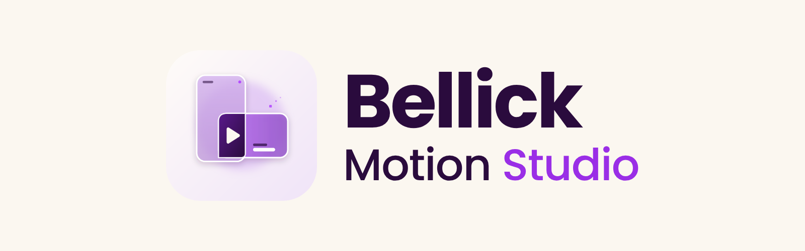

<p align="center">
  <picture>
    <source media="(prefers-color-scheme: dark)" srcset="assets/logo-wordmark-dark.png">
    
  </picture>
</p>

# Bellick Motion Studio

Turn talking-head clips and scripts into branded motion-design videos, in **your** brand, for any product you promote.

- **Brand Studio:** pull colours from your logo, then mix your brand on a colour wheel with live preview and readability checks
- **Choose your style:** full motion design, partial with graphics over your footage, or partial with mixed cuts between you on camera and animated scenes
- Product fact-checking, so your on-screen claims stay accurate
- **Optional sound:** original, copyright-free music (calm, upbeat or minimal) and sound effects timed to the animation, or your own track. Music ducks under your voice automatically. Off unless you choose it.
- Optional AI voiceover
- **Choose your export quality:** fast 720p preview, Full HD or 4K, with a time estimate for each before it renders, always in the **same shape as your original video**

Your videos use your brand, never mine.

## Install

**In the Claude app (web or desktop)**
1. Open **Customize → Plugins**.
2. Choose **Add marketplace** and enter `Bellickkruz/bellick-motion-studio`.
3. Find **Bellick Motion Studio** and choose **Install**.
4. On the marketplace, turn on **Sync automatically** to get updates as they're released.

**In Claude Code**
```
/plugin marketplace add Bellickkruz/bellick-motion-studio
/plugin install bellick-motion-studio@bellick-kruz
```
To receive updates automatically, open `/plugin` → **Marketplaces** → **bellick-kruz** → **Enable auto-update**.

## Use
In a new chat, say **"Bellick Motion Studio"** or *"make a branded video from this clip"* and upload your video. The first time, it walks you through setting up your brand and product.

## Requirements
- A paid Claude plan with code execution and file creation turned on
- On first use in a chat, about 1GB of open-source speech and voice models download from GitHub
- English transcription and voice

## Licence
Free to use for creating your videos, including sponsored ones. **Not open source:** copying, modifying or redistributing the plugin is not permitted. See [LICENSE](LICENSE).

© 2026 Bellick Kruz
